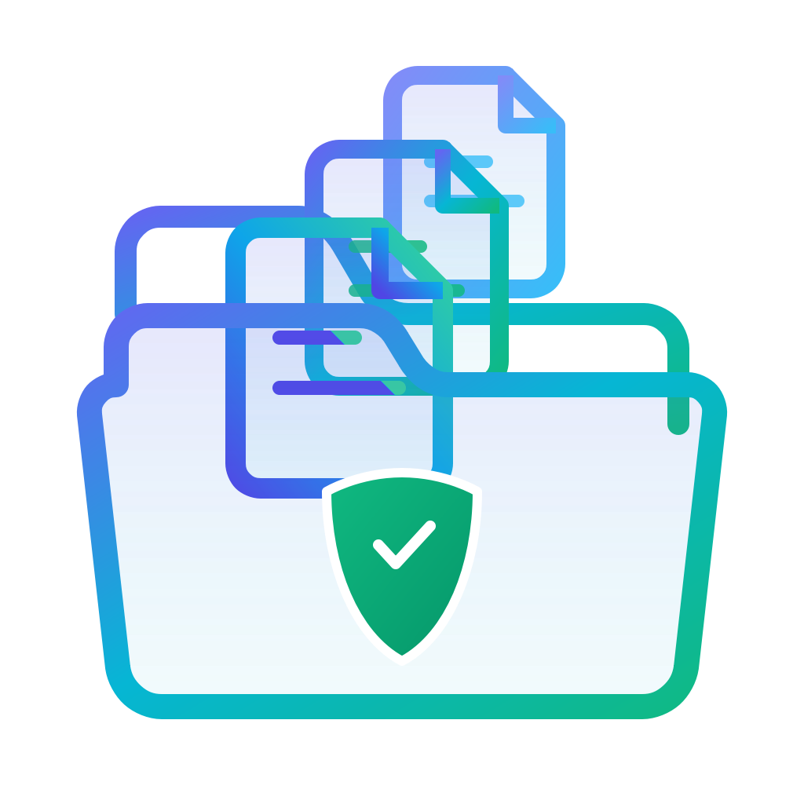

<p align="center">
  
</p>

<h1 align="center">ClutterXP</h1>

<p align="center">
  <strong>Configurable, safe, lightweight file organizer for Linux.</strong><br>
  Tidies downloads, documents, and messy directories into place—on your terms, with zero risk of file loss.
</p>

---

| Category | Badges |
|:---|:---|
| **Package** | [](https://pypi.org/project/clutterxp/) [](https://pypi.org/project/clutterxp/) [](https://github.com/aigo-admin/clutterxp/blob/main/LICENSE) |
| **Quality** | [](https://github.com/aigo-admin/clutterxp) [](https://github.com/astral-sh/ruff) [](http://mypy-lang.org/) |
| **Safety** | [](https://github.com/aigo-admin/clutterxp) [](https://github.com/aigo-admin/clutterxp) |

---

## What is it?

**ClutterXP** is a modern, fast, and reliable file organization toolkit designed for developers, power users, and everyday Linux users who want an organized workspace. Whether your `Downloads` folder is buried under months of receipts, PDFs, installers, wallpapers, and screenshots, or you want background auto-sorting for incoming files, ClutterXP handles the job with ironclad safety guarantees:

- **Never deletes or overwrites**: Files only move when the destination is safe. If a file with the same name exists, ClutterXP automatically renames the incoming file (e.g., `report (1).pdf`) or skips it. Your existing files are never destroyed.
- **Only moves what you tell it to**: If a file does not match a configured rule, it stays untouched in its original location. No unexpected moves, no mystery dump directories.
- **One-click instant undo**: Every operation is logged in an ACID SQLite journal. Run `clutterxp undo` (or click Undo in the GUI) to restore files to their exact original locations.
- **100% private and offline**: Operates entirely on your local machine. No tracking, no cloud telemetry, and zero network calls.

---

## Table of Contents

- [Main Features](#main-features)
- [Where to Get It](#where-to-get-it)
- [Quickstart: Desktop App](#quickstart-desktop-app)
- [Quickstart: Command Line](#quickstart-command-line)
- [Background Watcher Daemon](#background-watcher-daemon)
- [Duplicate File Quarantine](#duplicate-file-quarantine)
- [Customize Your Rules](#customize-your-rules)
- [Cheat Sheet](#cheat-sheet)
- [Dependencies](#dependencies)
- [License](#license)

---

## Main Features

- **Modern Minimalist Desktop App**: Clean obsidian-dark interface with one-click presets, visual plan previews, and real-time rule match testing.
- **Token-Aware Rule Engine**: Intelligent keyword matching that understands camelCase, PascalCase, hyphenated names, and compound extensions (e.g. `.tar.gz`).
- **Background Watcher**: Monitors designated folders using inotify with built-in settle and debounce to ensure browser downloads finish before moving.
- **Duplicate Detector & Safe Quarantine**: Multi-stage duplicate detection (size -> hardlinks -> head/tail partial hash -> streaming SHA-256) with safe quarantine isolation.
- **Instant LIFO Batch Undo**: Complete rollback capability for any batch of moves or quarantine actions.
- **Dual CLI Aliases**: Use full `clutterxp` or short alias `cxp` interchangeably.

---

## Where to Get It

### Binary Installation via PyPI

Install ClutterXP using Python 3.10+:

```bash
# Recommended: install with modern desktop app (GUI) support
pip install "clutterxp[gui]"

# CLI-only lightweight install
pip install clutterxp

# Or on Kali Linux / Debian / Ubuntu via pipx:
pipx install "clutterxp[gui]"
```

---

## Quickstart: Desktop App

Launch the visual application with:

```bash
clutterxp gui
```

The desktop app provides:
- **Interactive Plan Preview**: Review every planned move with clear status badges before touching any files.
- **Rule Editor with Presets**: One-click setup for common categories (Invoices, Photos, Installers) plus live matching test as you type.
- **Duplicate Quarantine**: Safely isolate duplicate downloads without risking accidental deletion.
- **Batch History & Undo**: Restore any previous batch with a single click.

---

## Quickstart: Command Line

Prefer the terminal? Use `clutterxp` or the shorthand `cxp`:

```bash
# 1. Create your default starter config
clutterxp init

# 2. Test which rule matches a filename
clutterxp rules test "invoice_march.pdf"

# 3. Preview what would be organized (dry-run, touches nothing)
clutterxp organize ~/Downloads --dry-run

# 4. Organize your Downloads folder
clutterxp organize ~/Downloads --yes

# 5. Changed your mind? Undo the entire batch instantly!
clutterxp undo --yes
```

---

## Background Watcher Daemon

Turn on automatic sorting. When a new file is downloaded or moved into a watched folder, ClutterXP waits until it is fully written to disk, then quietly sorts it into place:

```bash
clutterxp watch
```

You can also install it as a systemd user service:

```bash
clutterxp service install
clutterxp service status
```

---

## Duplicate File Quarantine

Identify duplicate files taking up storage and safely isolate them:

```bash
clutterxp duplicates scan ~/Downloads
```

---

## Customize Your Rules

Rules are clean and human-readable. Group by keywords, file extensions, size, or date:

- *"Move files containing `invoice` or `receipt` to `~/Documents/Invoices/{year}/{month}`"*
- *"Move `.png` and `.jpg` with `wallpaper` to `~/Pictures/Wallpapers`"*
- *"Move `.deb`, `.iso`, `.rpm` to `~/Downloads/Installers`"*

Edit rules in the desktop GUI or directly via `clutterxp rules add`.

---

## Cheat Sheet

| What you want to do | Command |
|:---|:---|
| Open the visual desktop app | `clutterxp gui` |
| Check version | `clutterxp --version` or `cxp --version` |
| Create default starter config | `clutterxp init` |
| Test rule matching on a filename | `clutterxp rules test "invoice_march.pdf"` |
| Preview organization without moving files | `cxp organize ~/Downloads --dry-run` |
| Organize a folder | `cxp organize ~/Downloads` |
| Undo the last batch of moves | `cxp undo` |
| Watch a folder and sort new files automatically | `cxp watch` |
| Install background watcher service | `cxp service install` |
| Check background service status | `cxp service status` |
| Scan for duplicate files | `cxp duplicates scan ~/Downloads` |
| Check system health and file integrity | `cxp doctor` |
| View organization history | `cxp history` |

---

## Dependencies

- **Python**: `>= 3.10`
- **Core CLI**: `typer`, `pydantic`, `ruamel.yaml`, `watchdog`, `platformdirs`
- **Optional GUI**: `PySide6` (`pip install "clutterxp[gui]"`)

---

## License

[MIT](LICENSE)
